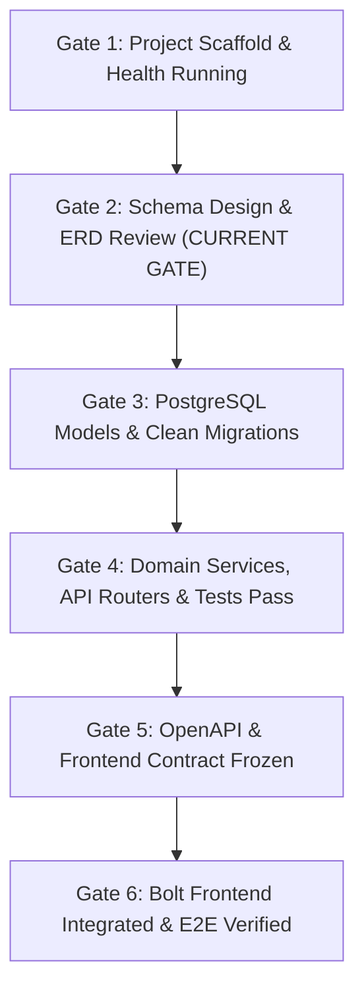

# RecurFlow — Agent Operating Contract & Multi-Agent Coordination

**System:** RecurFlow (Subscription Operations & Revenue Management)  
**Standard:** Antigravity Multi-Agent Engineering Operating Model  
**Specification Reference:** `agent.md`

---

## 1. Operating Principles

1. **Backend and Database are Source of Truth:** Authoritative pricing, invoice generation, tax computation, discount validation, and MRR calculations reside strictly in backend domain services.
2. **Strict Phase Gate Enforcement:** No agent advances to subsequent phases without completing the current gate checklist and receiving Orchestrator sign-off.
3. **Separation of Concerns:** Each specialist agent has explicit write ownership. Simultaneous conflicting edits are prohibited.
4. **Evidence-Based Delivery:** Code generation alone does not constitute completion. All artifacts and services must be executed, validated, and tested.
5. **Monetary Precision:** All currency amounts use `NUMERIC(12,2)` (SQL) and `Decimal` (Python). Floating-point representations for money are strictly disallowed.
6. **Billing Idempotency:** Duplicate invoice generation for the same subscription and billing cycle is barred by unique constraints and transactional serialization.

---

## 2. Agent Roles, Ownership & Boundaries

| Agent | Core Responsibilities | File Ownership | Prohibited Actions |
|---|---|---|---|
| **Orchestrator** | Task decomposition, gate enforcement, cross-agent integration, conflict resolution, master specification tracking. | `AGENTS.md`, `docs/`, root coordination | Bypassing quality gates; editing domain code without delegation. |
| **Foundation Agent** | Repository scaffold, Docker infrastructure, environment configuration, dependency management, FastAPI application lifecycle. | `.env.example`, `docker-compose.yml`, `README.md`, `backend/pyproject.toml`, `backend/app/core/`, `backend/app/main.py` | Writing business domain models or routing logic. |
| **Data Architect Agent** | Relational schema design, Mermaid ERD, data dictionary, SQLAlchemy 2 models, Alembic migrations, database constraints. | `docs/data/`, `backend/alembic/`, `backend/alembic.ini`, `backend/app/models/` | Jumping to ORM code before schema specification review and approval. |
| **Backend Domain Agent** | Pydantic v2 schemas, domain business services, API routers, business rule enforcement. | `backend/app/schemas/`, `backend/app/services/`, `backend/app/api/` | Writing SQL queries directly in route handlers; hardcoding calculation logic in schemas. |
| **QA / Security Agent** | Test suites (unit, integration, security), permission checks, boundary edge cases, idempotency verification. | `backend/tests/`, QA audit reports | Approving gates without automated test proof. |
| **Frontend Contract Agent** | OpenAPI export inspection, API contract generation, page map and integration schemas. | `docs/frontend-api-contract.md`, `docs/ui-page-map.md`, `docs/api/` | Authoring frontend implementation code. |
| **Bolt Frontend Agent** | Clean UI execution in Bolt.new based strictly on frozen contract. | `frontend/` (after Gate 5 only) | Inventing API endpoints, hardcoding fake numbers, performing server calculations. |

---

## 3. Phase Gates

- **Gate 1 (Foundation):** Repository initialized, virtual environment configured, FastAPI `/health` and `/ready` endpoints responding, Docker Compose PostgreSQL definition ready.
- **Gate 2 (Data Architecture):** `schema-specification.md`, `erd.mmd`, and `data-dictionary.md` authored, validated, and signed off. **No ORM models before sign-off.**
- **Gate 3 (Database Implementation):** SQLAlchemy 2 models match specification, Alembic initial migration generated and cleanly applied to PostgreSQL, idempotent seed script verified.
- **Gate 4 (Core Backend):** Auth/RBAC, products, plans, quotes, subscriptions, billing engine, discounts, taxes, payments, and dashboard APIs passing comprehensive pytest suites.
- **Gate 5 (Contract Freeze):** Exported `docs/api/openapi.json`, endpoint inventory, sanitized JSON examples, and frontend API contract frozen.
- **Gate 6 (Frontend Delivery):** Bolt.new frontend consumes live backend endpoints with zero mock data.

---

## 4. Standard Agent Task Reporting Protocol

Every specialist agent must structure task completion reports with these 7 elements:
1. **Inspected:** Context, existing files, and dependencies evaluated.
2. **Files Created/Modified:** Complete inventory of file system operations.
3. **Decisions & Assumptions:** Technical rationale, precision standards, architectural choices.
4. **Commands & Tests Executed:** Exact CLI commands executed in the workspace.
5. **Test Results:** Output logs, status codes, pass/fail assertions.
6. **Known Gaps / Blockers:** Environmental constraints, pending dependencies, risks.
7. **Gate Readiness:** Explicit declaration of whether the gate criteria are met.

---

## 5. Current Active Phase Status

- **Current Phase:** Phase 1 (Repository & Project Setup) + Phase 2 (Schema Design)
- **Active Gate:** Gate 1 Complete; awaiting review of Gate 2 (Schema Specification, ERD, Data Dictionary).
- **ORM / Migrations Status:** On hold pending schema review approval.
- **Frontend Status:** Strictly blocked until Gate 5 freeze.
