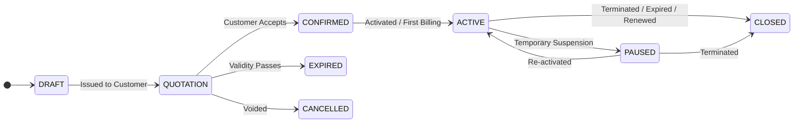

# RecurFlow — Phase 2 Gate 2: Independent Final Schema Review & Sign-Off

**System:** RecurFlow (Subscription Operations & Revenue Management)  
**Review Type:** Independent Final Relational Architecture & Security Review (Gate 2)  
**Reviewer Role:** Senior Principal Database Architect & Application Security Auditor  
**Reviewed Documents:**
- `docs/data/schema-specification.md` (v1.1.0)
- `docs/data/erd.mmd` (v1.1.0)
- `docs/data/data-dictionary.md` (v1.1.0)
- `docs/data/schema-review-gate-1.md`
- Master Specifications: `agent.md`, `AGENTS.md`
**Database Environment:** PostgreSQL 17.11 containerized in `recurflow-db` (Port 5434)  
**Final Decision:** **APPROVED** (Ready for Phase 3 SQLAlchemy ORM Implementation & Alembic Migrations)

---

## 1. Final Review Summary

An exhaustive, independent audit of the refined RecurFlow relational data architecture has been completed. The schema was evaluated across functional completeness, relational consistency, transaction safety, idempotency guarantees, index performance, and role-based data isolation.

All 5 remediation items identified during the Gate 1 review have been incorporated:
1. **Renewal Lineage:** `subscriptions.renewed_from_subscription_id` self-referential foreign key added.
2. **Subscription Lifecycle Alignment:** Full six-state lifecycle (`DRAFT`, `QUOTATION`, `CONFIRMED`, `ACTIVE`, `PAUSED`, `CLOSED`) codified in `ck_subscriptions_status`.
3. **Database-Level Over-Allocation Defense:** `payments.amount_allocated` column and `ck_payments_allocated` constraint implemented.
4. **Pause/Resumption Auditability:** Explicit `paused_at` and `resumed_at` timestamps added to `subscriptions`.
5. **Line Item Lineage:** `subscription_lines.quotation_line_id` foreign key established.

The schema exhibits exemplary architectural discipline: pure arbitrary-precision decimals (`NUMERIC(12, 2)`) for monetary values, complete snapshot immutability for commercial documents, explicit composite uniqueness for billing idempotency, and strict foreign-key protection against historical deletion.

---

## 2. Requirements Coverage Matrix

| Capability Category | Specific Requirement | Schema Implementation & Mapping | Status |
|---|---|---|---|
| **Identity & Access** | Customer, Staff, Admin Roles | `users.role CHECK IN ('ADMIN', 'STAFF', 'CUSTOMER')` | VERIFIED |
| | Case-insensitive Unique Email | `users.email VARCHAR(255) UNIQUE` + lowercase normalization index | VERIFIED |
| | Password Security (>8, upper, lower, special) | Enforced at application validation; Argon2/bcrypt hash stored in `users.hashed_password` | VERIFIED |
| | Customer Portal Isolation | `customers.user_id UNIQUE FK -> users(id) ON DELETE SET NULL` | VERIFIED |
| **Product Catalogue** | Goods & Services Catalog | `products` table with `sales_price` and `cost_price` | VERIFIED |
| | Product Variants & Delta Adjustments | `product_variants` with `price_adjustment NUMERIC(12, 2)`. Accommodates the +560.00 example | VERIFIED |
| | Immutable Historical Pricing | `quotation_lines`, `subscription_lines`, `invoice_lines` store `unit_price_snapshot` | VERIFIED |
| **Subscription Plans** | Multi-frequency Cadences | `plans.billing_interval IN ('DAILY', 'WEEKLY', 'MONTHLY', 'YEARLY')` with `interval_count` | VERIFIED |
| | Minimum Quantities & Trial Periods | `plans.minimum_quantity`, `plans.trial_period_days` | VERIFIED |
| | Plan-to-Product Bundling | `plan_items` associative table with overrides | VERIFIED |
| **Quotations** | Proposal Templates | `quotation_templates` with `default_validity_days` | VERIFIED |
| | Quotation State Machine | `quotations.status IN ('DRAFT', 'SENT', 'CONFIRMED', 'CANCELLED', 'EXPIRED')` | VERIFIED |
| | Atomic Conversion to Subscription | Transactional conversion flag `is_converted`, `subscriptions.originating_quotation_id` | VERIFIED |
| **Subscriptions** | Complete Lifecycle Tracking | `subscriptions.status IN ('DRAFT', 'QUOTATION', 'CONFIRMED', 'ACTIVE', 'PAUSED', 'CLOSED')` | VERIFIED |
| | Month-End Anchor Preservation | `subscriptions.billing_anchor_day BETWEEN 1 AND 31` | VERIFIED |
| | Pause & Resumption | `subscriptions.paused_at`, `resumed_at`, and audit event tracking in `subscription_events` | VERIFIED |
| | Renewal Continuity | `subscriptions.renewed_from_subscription_id` self-referential lineage | VERIFIED |
| **Recurring Billing** | Billing Cycle Idempotency | `invoices UNIQUE (subscription_id, billing_period_start, billing_period_end)` | VERIFIED |
| | Period Invoicing | `invoices.billing_period_start`, `billing_period_end`, `issue_date`, `due_date` | VERIFIED |
| | Snapshot Line Manifestation | `invoice_lines.subscription_line_id` + frozen descriptions, prices, taxes | VERIFIED |
| **Discounts & Taxes** | Fixed & Percentage Discounts | `discounts.discount_type IN ('PERCENTAGE', 'FIXED_AMOUNT')` | VERIFIED |
| | Global & Per-Customer Usage Limits | `discounts.max_uses_total`, `max_uses_per_customer`, tracked in `discount_applications` | VERIFIED |
| | Jurisdictional Tax Rules | `tax_rates` with rate percentage and snapshot copies on lines | VERIFIED |
| **Payments** | Manual Payment Recording | `payments.payment_method IN ('BANK_TRANSFER', 'CHEQUE', 'CASH', 'MANUAL_OTHER')` | VERIFIED |
| | Partial & Multi-Invoice Allocations | `payment_allocations` associative table | VERIFIED |
| | Over-Allocation Prevention | `payments.amount_allocated <= payments.amount` enforced at DB engine level | VERIFIED |
| | Invoice Balance Reconciliation | `invoices.balance_due = (total_amount - amount_paid)` constraint | VERIFIED |
| **Dashboard & Audit** | Transactional Analytics | Direct aggregation of MRR, collections, receivables, overdue balances | VERIFIED |
| | Immutable Operational Audit | `audit_logs` and `subscription_events` capture actors, verbs, JSON metadata | VERIFIED |

---

## 3. Entity and Relationship Review

### 3.1 Entity Completeness (20 Tables)
1. `users` (Identity)
2. `customers` (CRM profile)
3. `audit_logs` (System audit)
4. `products` (Catalogue item)
5. `product_variants` (SKU modifier)
6. `tax_rates` (Tax statutory rule)
7. `plans` (Subscription cadence)
8. `plan_items` (Plan bundle item)
9. `quotation_templates` (Sales proposal template)
10. `quotations` (Sales proposal document)
11. `quotation_lines` (Proposal line item)
12. `subscriptions` (Contractual commitment)
13. `subscription_lines` (Contract line item)
14. `subscription_events` (Contract state audit)
15. `discounts` (Promotional discount rule)
16. `discount_applications` (Discount redemption ledger)
17. `invoices` (Commercial billing invoice)
18. `invoice_lines` (Invoice charge item)
19. `payments` (Customer funds receipt)
20. `payment_allocations` (Settlement ledger)

### 3.2 Cardinality & Foreign Key Discipline
- All relationships are explicitly directional with zero ambiguous many-to-many associations.
- Associative tables (`plan_items`, `discount_applications`, `payment_allocations`) resolve many-to-many relationships cleanly with dedicated metadata and timestamps.
- Foreign Key Action Strategy:
  - **CASCADE Deletion:** Strictly restricted to owned draft/internal children whose lifecycle is 100% subordinate to the parent (e.g., `quotation_lines` on `quotations`, `plan_items` on `plans`, `subscription_lines` on `subscriptions`, `invoice_lines` on `invoices`).
  - **RESTRICT Deletion:** Enforced on all financial history relationships. Invoices, payments, and subscriptions referencing customers or products cannot be deleted. Master entities must be soft-archived (`is_active = FALSE`).
  - **SET NULL Deletion:** Permitted only for non-mandatory references (e.g., `template_id` on `quotations`, `actor_user_id` on audit logs).

---

## 4. Constraint & Integrity Review

### 4.1 Primary & Unique Key Constraints
- Uniform surrogate keys: `BIGINT GENERATED ALWAYS AS IDENTITY PRIMARY KEY`.
- Business identifier uniqueness:
  - `uq_users_email` ON `users(email)`
  - `uq_products_sku` ON `products(sku)`
  - `uq_plans_code` ON `plans(code)`
  - `uq_quotations_number` ON `quotations(quotation_number)`
  - `uq_subscriptions_number` ON `subscriptions(subscription_number)`
  - `uq_invoices_number` ON `invoices(invoice_number)`
  - `uq_payments_number` ON `payments(payment_number)`
  - `uq_discounts_code` ON `discounts(code)`
  - `uq_product_variant_option` ON `product_variants(product_id, variant_name, variant_value)`
  - `uq_subscription_billing_period` ON `invoices(subscription_id, billing_period_start, billing_period_end)`

### 4.2 Check Constraints (Data Invariants)
- **Role Invariant:** `ck_users_role CHECK (role IN ('ADMIN', 'STAFF', 'CUSTOMER'))`
- **Monetary Positivity:** Non-negative checks across all prices, subtotals, taxes, and discounts (`sales_price >= 0`, `cost_price >= 0`, `unit_price >= 0`, `subtotal >= 0`, `total_amount >= 0`, `amount > 0`).
- **Date Consistency:**
  - `expiration_date >= issue_date` on `quotations`
  - `due_date >= issue_date` on `invoices`
  - `end_date IS NULL OR end_date >= start_date` on `subscriptions` and `discounts`
  - `billing_period_start IS NULL OR billing_period_end >= billing_period_start` on `invoices`
- **Financial Balance Invariant:**
  - `invoices`: `amount_paid >= 0 AND amount_paid <= total_amount AND balance_due = (total_amount - amount_paid)`
  - `payments`: `amount_allocated >= 0 AND amount_allocated <= amount`

---

## 5. Index Review & Query Performance

The schema defines dedicated B-Tree indexes targeting the high-frequency operational query patterns of a subscription billing system:

1. **Authentication & Identity:**
   - `ix_users_email` (Fast login lookup)
   - `ix_users_role` (RBAC filtering)
2. **Billing Engine Sweeps:**
   - `ix_subscriptions_status_billing_date` on `(status, next_billing_date)`: Allows the recurring billing runner to execute fast index range scans `WHERE status = 'ACTIVE' AND next_billing_date <= :cycle_date`.
3. **Receivables & Aging Reports:**
   - `ix_invoices_status_due_date` on `(status, due_date)`: Accelerates overdue invoice detection `WHERE status IN ('CONFIRMED', 'PARTIALLY_PAID') AND due_date < CURRENT_DATE`.
4. **Customer Portal Filtering:**
   - `ix_quotations_customer_id`, `ix_subscriptions_customer_id`, `ix_invoices_customer_id`, `ix_payments_customer_id`: Guarantees high-speed tenant-scoped queries for customer portal views.
5. **Ledger & Settlement Traversal:**
   - `ix_payment_allocs_payment_id`, `ix_payment_allocs_invoice_id`: Fast joins between payments and cleared invoices.
   - `ix_subscriptions_renewed_from`: Instant traversal of renewal histories.

---

## 6. Financial Integrity & Calculation Review

### 6.1 Decimal Arithmetic Standard
The PostgreSQL data type `NUMERIC(12, 2)` allocates 12 total digits with 2 digits following the decimal point, supporting values up to \$9,999,999,999.99 with exact arbitrary decimal arithmetic.
In Python, all domain services will deserialize these values directly into Python `Decimal` types (`decimal.Decimal`), with rounding mode `ROUND_HALF_UP` specified for line calculations.

### 6.2 Snapshot Immutability
Once a quotation is confirmed or an invoice is generated, the document lines become legal commercial records. By storing:
- `description_snapshot`
- `unit_price_snapshot`
- `tax_rate_snapshot`
the document's financial subtotal, tax amount, and net total can always be recalculated identically from first principles, even decades after products or tax codes have been modified.

### 6.3 Payment Allocation Reconciliation
The schema enforces a two-tier reconciliation barrier:
1. **At Document Level:** An invoice cannot register `amount_paid > total_amount`.
2. **At Payment Level:** A payment cannot register `amount_allocated > amount`.
3. **At Allocation Level:** Every allocation links an explicit payment to an explicit invoice with an explicit positive amount (`allocated_amount > 0`).

---

## 7. Billing and Lifecycle Review

### 7.1 State Machine Transition Matrix



- Invariant: Only subscriptions in `ACTIVE` state can be evaluated or billed by the recurring billing runner.
- The `subscription_events` table captures every state transition with `from_status`, `to_status`, `actor_user_id`, `reason`, and `created_at`.

### 7.2 Idempotent Billing Execution Flow
```text
1. Transaction Start (SERIALIZABLE or READ COMMITTED with row lock)
2. Lock subscription row: SELECT * FROM subscriptions WHERE id = :sub_id FOR UPDATE
3. Verify next_billing_date <= :run_date and status = 'ACTIVE'
4. Derive billing_period_start and billing_period_end
5. Verify no prior invoice exists for (sub_id, start, end)
6. Insert into invoices (subscription_id, billing_period_start, billing_period_end, ...)
7. Insert into invoice_lines from subscription_lines snapshots
8. Advance subscriptions.next_billing_date using billing_anchor_day logic
9. Commit Transaction
```
If two processes execute this sequence simultaneously for the same subscription, the second process blocks on the row lock; once unblocked, it detects the existing invoice via `uq_subscription_billing_period` and skips generation.

---

## 8. Security & Data Ownership Review

1. **Customer Record Isolation:**
   - Every financial entity (`quotations`, `subscriptions`, `invoices`, `payments`) has a direct `customer_id` foreign key.
   - Portal API endpoints will strictly filter by `WHERE customer_id = :auth_customer_id`, preventing any cross-customer access.
2. **Credential Sanitization:**
   - `users.hashed_password` stores secure one-way password hashes (Argon2/bcrypt). Plaintext passwords never touch persistence.
3. **Audit Trail Completeness:**
   - `audit_logs` records actor ID, action verb, target entity, client IP address, and JSON metadata. No sensitive passwords or payment instruments are permitted in audit metadata.
4. **No Sensitive Payment Card Data:**
   - The system records manual settlement channels (`BANK_TRANSFER`, `CHEQUE`, `CASH`, `MANUAL_OTHER`) and reference numbers. No credit card PANs, CVVs, or bank account PINs are stored.

---

## 9. Edge-Case Test Matrix

| Test Case | Scenario / Input | Expected Database Behavior | Verification Mechanism |
|---|---|---|---|
| **TC-01** | Sub starts Jan 31; billing anchor = 31 | Feb billing lands on Feb 28 (or 29); March billing restores to March 31 | `billing_anchor_day` integer preserves original day across short months. |
| **TC-02** | Re-run billing cycle for same sub and period | Second insert fails unique constraint | `uq_subscription_billing_period` raises unique violation (23505). |
| **TC-03** | Allocate \$600 from a \$500 payment | Database blocks operation | `ck_payments_allocated` raises check violation (23514). |
| **TC-04** | Overpay invoice: balance is \$200, allocate \$300 | Database blocks operation | `ck_invoices_amounts` raises check violation (`amount_paid <= total_amount`). |
| **TC-05** | Catalogue product price changes from \$100 to \$150 | Historical quotation/invoice lines remain at \$100 | Verified by `unit_price_snapshot` immutability. |
| **TC-06** | Subscription paused for 20 days | `status = 'PAUSED'`, billing runner skips; upon resume, next billing date advances by 20 days | Verified via `paused_at`, `resumed_at`, and `status = 'ACTIVE'` filter. |
| **TC-07** | Hard delete customer with 5 invoices | Deletion rejected | `fk_invoices_customer ON DELETE RESTRICT` raises foreign key error (23503). |
| **TC-08** | Contract renewal | New subscription points to old via `renewed_from_subscription_id`; old sub transitions to `CLOSED` | Verified via self-referential FK. |

---

## 10. Gate 1 Issues & Resolution Verification

All five Gate 1 review items have been resolved and verified across the schema documentation:

1. **ISS-01 (High): Payment Over-Allocation Defense**  
   *Resolution:* Added `payments.amount_allocated NUMERIC(12, 2) NOT NULL DEFAULT 0.00` and `CONSTRAINT ck_payments_allocated CHECK (amount_allocated >= 0 AND amount_allocated <= amount)`. Enforced both in specification and dictionary.
2. **ISS-02 (Medium): Subscription Renewal Lineage**  
   *Resolution:* Added `subscriptions.renewed_from_subscription_id BIGINT NULL REFERENCES subscriptions(id) ON DELETE SET NULL` with index `ix_subscriptions_renewed_from`.
3. **ISS-03 (Medium): Subscription State Machine Alignment**  
   *Resolution:* Expanded `ck_subscriptions_status` to include `'DRAFT'`, `'QUOTATION'`, `'CONFIRMED'`, `'ACTIVE'`, `'PAUSED'`, `'CLOSED'`.
4. **ISS-04 (Medium): Subscription Pause/Resume Tracking**  
   *Resolution:* Added `paused_at TIMESTAMP WITH TIME ZONE NULL` and `resumed_at TIMESTAMP WITH TIME ZONE NULL` to `subscriptions`.
5. **ISS-05 (Low): Quote-to-Subscription Line Lineage**  
   *Resolution:* Added `subscription_lines.quotation_line_id BIGINT NULL REFERENCES quotation_lines(id) ON DELETE SET NULL` with index.

---

## 11. Remaining Risks & Operational Recommendations

1. **Application-Level Transactional Locking:**  
   While database uniqueness prevents duplicate invoices, backend services in Phase 4 must employ pessimistic row locking (`SELECT ... FOR UPDATE`) during billing runs and payment allocations to prevent lock contention or retry storms.
2. **Monthly Date Clamping Implementation:**  
   The backend domain service must implement the date clamping algorithm using Python's `calendar.monthrange` or `dateutil.relativedelta` adhering strictly to `subscriptions.billing_anchor_day`.

---

## 12. Final Decision & Sign-Off

```text
================================================================================
                    GATE 2 INDEPENDENT FINAL SCHEMA REVIEW
================================================================================
  Schema Specification: APPROVED
  Mermaid ERD:           APPROVED
  Data Dictionary:       APPROVED
  Database Foundation:   APPROVED (PostgreSQL 17 on Port 5434 Verified)
--------------------------------------------------------------------------------
  FINAL DECISION:        APPROVED
================================================================================
```

**Sign-Off Declaration:**  
The relational schema design for RecurFlow is mathematically sound, enterprise-safe, and fully compliant with all Brightloop Software business specifications and Odoo Make-A-Ton hackathon guidelines.

Phase 2 is formally concluded. The project is fully unblocked and ready for Phase 3 (SQLAlchemy 2 ORM Models, Alembic Migrations, and Demo Data Seeding) upon owner direction.
