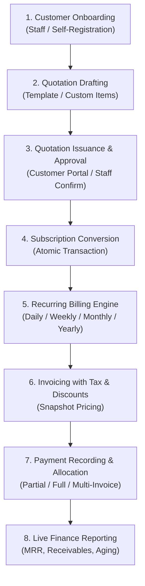
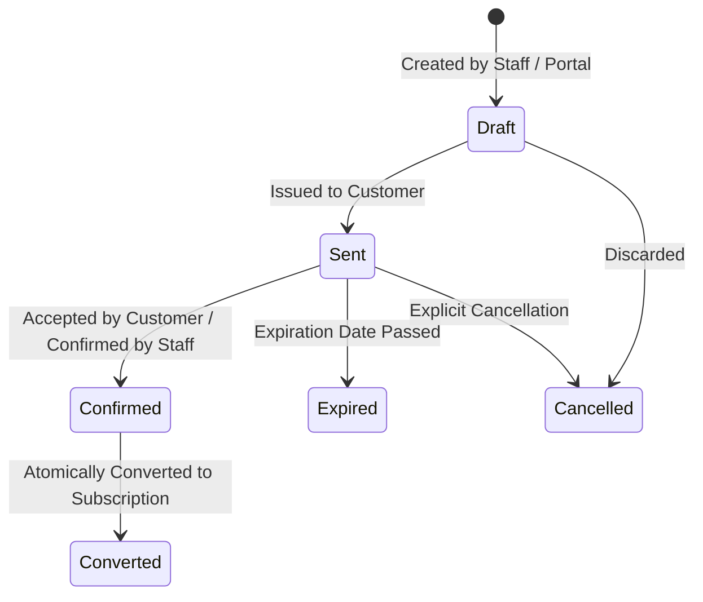
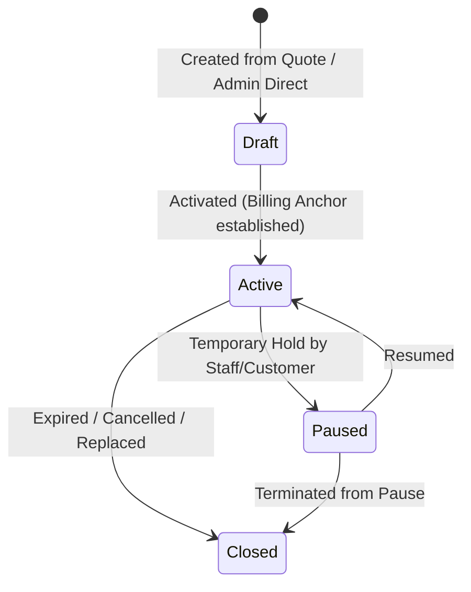
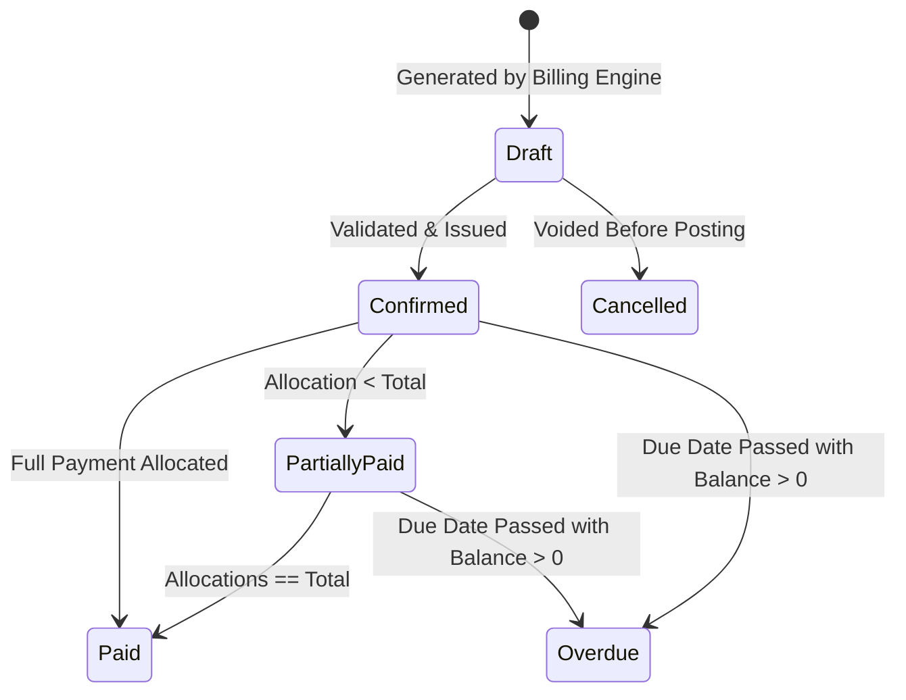

# End-to-End Business Workflow & Lifecycle Specifications

**Product:** RecurFlow — Subscription Operations & Revenue Management  
**Reference:** `agent.md` (Sections 0, 7, 8)

---

## 1. Master Commercial Workflow

---

## 2. Entity State Machine Transitions

### 2.1 Quotation State Machine

- **Invariants:**
  - A quotation cannot be confirmed after `expiration_date`.
  - Once converted, `quotations.is_converted` is set to `True` and `subscriptions.originating_quotation_id` links back. Re-conversion is strictly prohibited.

### 2.2 Subscription State Machine

- **Billing Invariants:**
  - Invoices are generated only when `status = 'ACTIVE'`.
  - Next billing date calculation:
    - Daily: `current + 1 day`
    - Weekly: `current + 7 days`
    - Monthly: preserves day-of-month anchor (handles Jan 31 $\to$ Feb 28/29 leap year clamping)
    - Yearly: `current + 1 year` (Feb 29 $\to$ Feb 28 on non-leap years)

### 2.3 Invoice State Machine

---

## 3. Recurring Billing Execution Protocol

1. **Identification:** The billing runner queries active subscriptions where `next_billing_date <= :cycle_run_date`.
2. **Locking & Concurrency Protection:** Each target subscription is acquired within a database transaction with row-level serialization (`FOR UPDATE`).
3. **Period Resolution:** Exact `billing_period_start` and `billing_period_end` are determined based on interval and count.
4. **Idempotency Verification:** An index lookup on `(subscription_id, billing_period_start, billing_period_end)` guarantees no prior invoice exists for this period. If one exists, the cycle skips the duplicate safely.
5. **Line Item Snapshots:** Invoice lines are constructed by copying descriptions, quantities, and unit prices from active subscription lines.
6. **Tax & Discount Processing:** Applicable tax rules and active discount eligibility (valid date range, remaining customer usage) are calculated using arbitrary-precision decimals.
7. **Document Creation & Date Advance:** The invoice record is persisted, and `subscriptions.next_billing_date` advances to the subsequent interval.
8. **Commit:** The transaction commits atomically.
